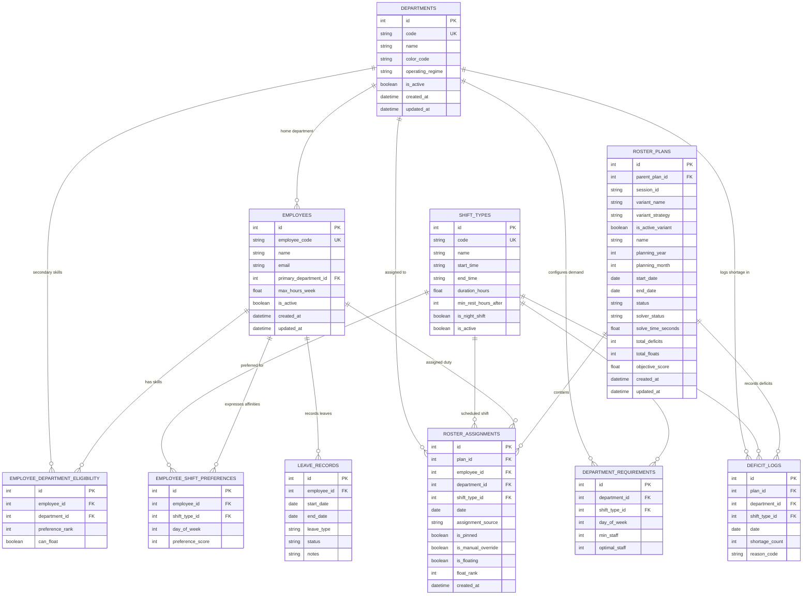

# Relational Data Model & Database Specification
## LocalRoster v2: Dynamic Offline Workforce Roster Planner

---

### 1. Database Architecture & Storage Engine

* **RDBMS Engine:** SQLite 3 (embedded local serverless database file: `localroster.db`).
* **ORM & Data Mapping:** SQLAlchemy 2.0 / SQLModel with SQLite-optimized WAL (`Write-Ahead Logging`) mode enabled.
* **Foreign Key Integrity:** Enforced via `PRAGMA foreign_keys = ON;` executed on every database connection.
* **Date & Time Standards:**
  - Dates: ISO 8601 string (`YYYY-MM-DD`).
  - Times: ISO 8601 string (`HH:MM:SS` or `HH:MM`).
  - Timestamps: UTC Unix epoch integers or ISO 8601 strings (`YYYY-MM-DDTHH:MM:SSZ`).

---

### 2. Entity-Relationship Diagram (ERD)



---

### 3. Detailed Table Specifications & DDL

#### 3.1 `departments`
Stores dynamic organizational units, hospital wards, or production lines.

```sql
CREATE TABLE departments (
    id INTEGER PRIMARY KEY AUTOINCREMENT,
    code VARCHAR(32) NOT NULL UNIQUE,
    name VARCHAR(128) NOT NULL,
    color_code VARCHAR(7) NOT NULL DEFAULT '#3B82F6', -- Hex color code (e.g. #3B82F6)
    operating_regime VARCHAR(16) NOT NULL DEFAULT '24_7' CHECK (operating_regime IN ('24_7', 'WEEKDAYS_ONLY', 'CUSTOM')),
    is_active BOOLEAN NOT NULL DEFAULT 1,
    created_at TIMESTAMP NOT NULL DEFAULT CURRENT_TIMESTAMP,
    updated_at TIMESTAMP NOT NULL DEFAULT CURRENT_TIMESTAMP
);

CREATE INDEX idx_departments_active ON departments(is_active);
```

#### 3.2 `shift_types`
Defines operational shift windows and ergonomic parameters.

```sql
CREATE TABLE shift_types (
    id INTEGER PRIMARY KEY AUTOINCREMENT,
    code VARCHAR(16) NOT NULL UNIQUE,
    name VARCHAR(64) NOT NULL,
    start_time VARCHAR(8) NOT NULL,          -- Format 'HH:MM:SS' e.g. '07:00:00'
    end_time VARCHAR(8) NOT NULL,            -- Format 'HH:MM:SS' e.g. '15:30:00'
    duration_hours REAL NOT NULL,            -- e.g. 8.5
    min_rest_hours_after INTEGER NOT NULL DEFAULT 14, -- Minimum rest required before next shift
    is_night_shift BOOLEAN NOT NULL DEFAULT 0,
    is_active BOOLEAN NOT NULL DEFAULT 1,
    created_at TIMESTAMP NOT NULL DEFAULT CURRENT_TIMESTAMP
);

CREATE INDEX idx_shift_types_active ON shift_types(is_active);
```

#### 3.3 `department_requirements`
Demand matrix specifying staffing requirements per department, shift, and day of week.

```sql
CREATE TABLE department_requirements (
    id INTEGER PRIMARY KEY AUTOINCREMENT,
    department_id INTEGER NOT NULL,
    shift_type_id INTEGER NOT NULL,
    day_of_week INTEGER NOT NULL CHECK (day_of_week BETWEEN 0 AND 6), -- 0 = Monday, 6 = Sunday
    min_staff INTEGER NOT NULL CHECK (min_staff >= 0),
    optimal_staff INTEGER NOT NULL CHECK (optimal_staff >= min_staff),
    FOREIGN KEY (department_id) REFERENCES departments(id) ON DELETE CASCADE,
    FOREIGN KEY (shift_type_id) REFERENCES shift_types(id) ON DELETE CASCADE,
    CONSTRAINT uq_dept_shift_dow UNIQUE (department_id, shift_type_id, day_of_week)
);

CREATE INDEX idx_dept_req_lookup ON department_requirements(department_id, day_of_week);
```

#### 3.4 `employees`
Workforce roster directory with primary department assignments.

```sql
CREATE TABLE employees (
    id INTEGER PRIMARY KEY AUTOINCREMENT,
    employee_code VARCHAR(32) NOT NULL UNIQUE,
    name VARCHAR(128) NOT NULL,
    email VARCHAR(128),
    primary_department_id INTEGER NOT NULL,
    max_hours_week REAL NOT NULL DEFAULT 40.0 CHECK (max_hours_week > 0),
    is_active BOOLEAN NOT NULL DEFAULT 1,
    created_at TIMESTAMP NOT NULL DEFAULT CURRENT_TIMESTAMP,
    updated_at TIMESTAMP NOT NULL DEFAULT CURRENT_TIMESTAMP,
    FOREIGN KEY (primary_department_id) REFERENCES departments(id) ON DELETE RESTRICT
);

CREATE INDEX idx_employees_active_dept ON employees(is_active, primary_department_id);
```

#### 3.5 `employee_department_eligibility`
Configures cross-department skills, floating eligibility, and priority ranks.

```sql
CREATE TABLE employee_department_eligibility (
    id INTEGER PRIMARY KEY AUTOINCREMENT,
    employee_id INTEGER NOT NULL,
    department_id INTEGER NOT NULL,
    preference_rank INTEGER NOT NULL DEFAULT 2 CHECK (preference_rank IN (1, 2, 3)), -- 1=Home, 2=Qualified Float, 3=Emergency Float
    can_float BOOLEAN NOT NULL DEFAULT 1,
    FOREIGN KEY (employee_id) REFERENCES employees(id) ON DELETE CASCADE,
    FOREIGN KEY (department_id) REFERENCES departments(id) ON DELETE CASCADE,
    CONSTRAINT uq_emp_dept UNIQUE (employee_id, department_id)
);

CREATE INDEX idx_emp_dept_elig ON employee_department_eligibility(employee_id, department_id);
```

#### 3.6 `employee_shift_preferences`
Captures employee affinities or aversions for specific shifts and days.

```sql
CREATE TABLE employee_shift_preferences (
    id INTEGER PRIMARY KEY AUTOINCREMENT,
    employee_id INTEGER NOT NULL,
    shift_type_id INTEGER NOT NULL,
    day_of_week INTEGER NOT NULL CHECK (day_of_week BETWEEN 0 AND 6),
    preference_score INTEGER NOT NULL DEFAULT 0 CHECK (preference_score BETWEEN -5 AND 5), -- -5=Strong Dislike, 0=Neutral, +5=Strong Preference
    FOREIGN KEY (employee_id) REFERENCES employees(id) ON DELETE CASCADE,
    FOREIGN KEY (shift_type_id) REFERENCES shift_types(id) ON DELETE CASCADE,
    CONSTRAINT uq_emp_shift_dow UNIQUE (employee_id, shift_type_id, day_of_week)
);

CREATE INDEX idx_emp_pref ON employee_shift_preferences(employee_id);
```

#### 3.7 `leave_records`
Pre-approved unavailabilities (Annual Leave, Sick, Training) acting as hard locks.

```sql
CREATE TABLE leave_records (
    id INTEGER PRIMARY KEY AUTOINCREMENT,
    employee_id INTEGER NOT NULL,
    start_date DATE NOT NULL,
    end_date DATE NOT NULL,
    leave_type VARCHAR(32) NOT NULL CHECK (leave_type IN ('VACATION', 'SICK', 'TRAINING', 'UNPAID', 'OTHER')),
    status VARCHAR(16) NOT NULL DEFAULT 'APPROVED' CHECK (status IN ('PENDING', 'APPROVED', 'CANCELLED')),
    notes TEXT,
    FOREIGN KEY (employee_id) REFERENCES employees(id) ON DELETE CASCADE,
    CHECK (end_date >= start_date)
);

CREATE INDEX idx_leave_dates ON leave_records(employee_id, start_date, end_date);
```

#### 3.8 `roster_plans`
Stores discrete scheduling horizons, execution metadata, and aggregate solve metrics.

```sql
CREATE TABLE roster_plans (
    id INTEGER PRIMARY KEY AUTOINCREMENT,
    parent_plan_id INTEGER,                            -- Self-reference for plan lineage/forks
    session_id VARCHAR(64) NOT NULL,                   -- Groups candidate variants generated together
    variant_name VARCHAR(64) NOT NULL DEFAULT 'Variant A', -- e.g. 'Variant A (Balanced)', 'Variant B (Min Float)'
    variant_strategy VARCHAR(64) NOT NULL DEFAULT 'BALANCED', -- 'BALANCED', 'FLOAT_AVERSE', 'PREFERENCE_MAX', 'CUSTOM'
    is_active_variant BOOLEAN NOT NULL DEFAULT 1,      -- 1 if selected/promoted variant, 0 for alternative candidates
    name VARCHAR(128) NOT NULL,
    planning_year INTEGER,                             -- e.g. 2026
    planning_month INTEGER CHECK (planning_month BETWEEN 1 AND 12), -- e.g. 11
    start_date DATE NOT NULL,
    end_date DATE NOT NULL,
    status VARCHAR(16) NOT NULL DEFAULT 'DRAFT' CHECK (status IN ('DRAFT', 'GENERATING', 'SOLVED', 'PUBLISHED', 'ARCHIVED')),
    solver_status VARCHAR(32),                         -- 'OPTIMAL', 'FEASIBLE', 'DEFICIT_RESOLVED', 'ERROR'
    solve_time_seconds REAL,
    total_deficits INTEGER NOT NULL DEFAULT 0,
    total_floats INTEGER NOT NULL DEFAULT 0,
    objective_score REAL,
    created_at TIMESTAMP NOT NULL DEFAULT CURRENT_TIMESTAMP,
    updated_at TIMESTAMP NOT NULL DEFAULT CURRENT_TIMESTAMP,
    FOREIGN KEY (parent_plan_id) REFERENCES roster_plans(id) ON DELETE SET NULL,
    CHECK (end_date >= start_date)
);

CREATE INDEX idx_roster_plans_session ON roster_plans(session_id);
CREATE INDEX idx_roster_plans_lookup ON roster_plans(planning_year, planning_month, is_active_variant);
CREATE INDEX idx_roster_plans_dates ON roster_plans(start_date, end_date);
```

#### 3.9 `roster_assignments`
The generated or manually adjusted shift allocations for each employee.

```sql
CREATE TABLE roster_assignments (
    id INTEGER PRIMARY KEY AUTOINCREMENT,
    plan_id INTEGER NOT NULL,
    employee_id INTEGER NOT NULL,
    department_id INTEGER NOT NULL,
    shift_type_id INTEGER NOT NULL,
    date DATE NOT NULL,
    assignment_source VARCHAR(16) NOT NULL DEFAULT 'SOLVER' CHECK (assignment_source IN ('SOLVER', 'PREFILLED', 'MANUAL_OVERRIDE')),
    is_pinned BOOLEAN NOT NULL DEFAULT 0,
    is_manual_override BOOLEAN NOT NULL DEFAULT 0,
    is_floating BOOLEAN NOT NULL DEFAULT 0,
    float_rank INTEGER DEFAULT 1,
    created_at TIMESTAMP NOT NULL DEFAULT CURRENT_TIMESTAMP,
    FOREIGN KEY (plan_id) REFERENCES roster_plans(id) ON DELETE CASCADE,
    FOREIGN KEY (employee_id) REFERENCES employees(id) ON DELETE CASCADE,
    FOREIGN KEY (department_id) REFERENCES departments(id) ON DELETE RESTRICT,
    FOREIGN KEY (shift_type_id) REFERENCES shift_types(id) ON DELETE RESTRICT,
    CONSTRAINT uq_plan_emp_date UNIQUE (plan_id, employee_id, date) -- Guarantees single shift per day
);

CREATE INDEX idx_assignment_plan_date ON roster_assignments(plan_id, date);
CREATE INDEX idx_assignment_dept_date ON roster_assignments(department_id, date);
CREATE INDEX idx_assignment_emp_date ON roster_assignments(employee_id, date);
CREATE INDEX idx_assignment_pinned ON roster_assignments(plan_id, is_pinned);
```

#### 3.10 `deficit_logs`
Actionable diagnostic records detailing unfilled demand slots and root-cause analysis.

```sql
CREATE TABLE deficit_logs (
    id INTEGER PRIMARY KEY AUTOINCREMENT,
    plan_id INTEGER NOT NULL,
    department_id INTEGER NOT NULL,
    shift_type_id INTEGER NOT NULL,
    date DATE NOT NULL,
    shortage_count INTEGER NOT NULL CHECK (shortage_count > 0),
    reason_code VARCHAR(64) NOT NULL, -- e.g. 'EXHAUSTED_ELIGIBLE_STAFF', 'CONCURRENT_LEAVES', 'ERGONOMIC_REST_RESTRICTION'
    FOREIGN KEY (plan_id) REFERENCES roster_plans(id) ON DELETE CASCADE,
    FOREIGN KEY (department_id) REFERENCES departments(id) ON DELETE CASCADE,
    FOREIGN KEY (shift_type_id) REFERENCES shift_types(id) ON DELETE CASCADE
);

CREATE INDEX idx_deficit_plan ON deficit_logs(plan_id, department_id, date);
```

---

### 4. Data Migration & Versioning Strategy

- **Schema Migrations:** Managed locally using lightweight SQL migration scripts embedded in the application binary or Alembic SQLite migrations.
- **Foreign Key Enforcement:** Run upon application bootstrap:
  ```python
  from sqlalchemy import event
  from sqlalchemy.engine import Engine

  @event.listens_for(Engine, "connect")
  def set_sqlite_pragma(dbapi_connection, connection_record):
      cursor = dbapi_connection.cursor()
      cursor.execute("PRAGMA foreign_keys=ON")
      cursor.execute("PRAGMA journal_mode=WAL")
      cursor.execute("PRAGMA synchronous=NORMAL")
      cursor.close()
  ```
- **Seeding & Scenarios:** The database will initialize with default shift types (Day, Evening, Night) and allow complete customization through the UI/API.
