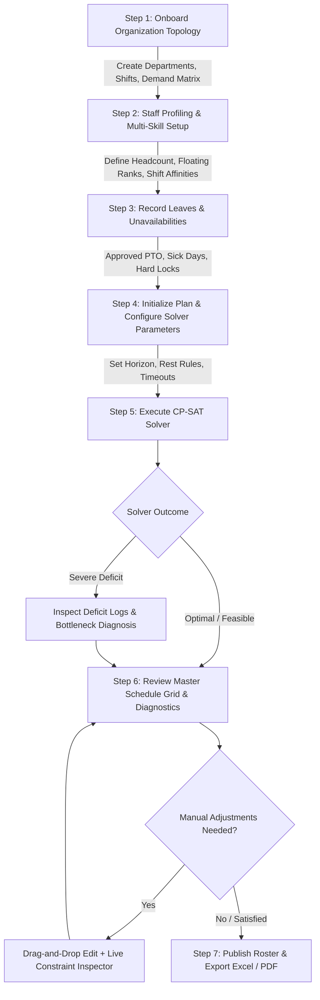

# Product Requirements Document (PRD)
## LocalRoster v2: Dynamic Offline Workforce Roster Planner

---

### 1. Executive Summary & Objective

**LocalRoster v2** is an offline-first, mathematically guaranteed workforce rostering and shift planning desktop application. The system solves complex multi-department staff scheduling challenges faced by healthcare facilities, emergency operations, manufacturing plants, customer support hubs, and hospitality organizations.

Unlike legacy rostering tools that depend on fixed organizational hierarchies, rigid rules, or remote SaaS infrastructures, LocalRoster v2:
- Supports arbitrary dynamic organizational topologies ($N$ departments, variable shift definitions, multi-skilled floaters).
- Formulates scheduling as an exact Constraint Programming problem using Google OR-Tools CP-SAT.
- Solves coverage shortages gracefully through a multi-tier floating mechanism and heavily penalized integer deficit slacks (never failing with an uninformative `INFEASIBLE` status).
- Enforces strict occupational safety and ergonomic labor constraints (rolling rest periods, maximum consecutive working days, forward shift rotations).
- Operates entirely offline on `localhost` without any remote network requests, CDNs, or telemetry.
- Packages as a single, lightweight desktop executable via PyInstaller and `pywebview`.

---

### 2. Operational Environment & Target Constraints

| Parameter | Specification |
| :--- | :--- |
| **Operating System** | Windows 10/11 (64-bit), macOS 12+, Ubuntu Linux 22.04+ LTS |
| **Network Footprint** | Strict air-gapped / offline operation. Zero outbound HTTP/HTTPS requests. Zero external CDNs. |
| **Hosting Model** | Local embedded runtime: Python 3.11+ (FastAPI background daemon) + SQLite + Webview desktop window. |
| **Packaging Target** | Standalone bundle via PyInstaller bundled with `pywebview` desktop wrapper. |
| **Export Formats** | Multi-sheet formatted Excel (`.xlsx` via `openpyxl`), vector print-ready PDF schedules. |

---

### 3. Scale & Performance Benchmarks

The system is designed to scale flexibly across various organization sizes:

| Dimension | Small Deployment | Target Mid-Range (Default) | Stress-Test / Maximum |
| :--- | :--- | :--- | :--- |
| **Departments ($|D|$)** | 1 – 3 | 5 – 15 | Up to 50 |
| **Total Headcount ($|E|$)** | 4 – 20 | 30 – 100 | Up to 500 |
| **Shift Types ($|S|$)** | 2 – 3 (e.g. Day, Night) | 3 – 5 (e.g. Early, Day, Swing, Night) | Up to 12 |
| **Planning Horizon ($|T|$)**| 7 – 14 days | 28 – 31 days (1 Month) | 90 days (Quarterly) |
| **Decision Variables** | $\sim 10^3$ | $5 \times 10^4 - 2 \times 10^5$ | $\sim 2 \times 10^6$ |
| **Solver Convergence Target** | $< 1.5$ seconds | $\le 10$ seconds | $\le 45$ seconds |

---

### 4. Core System Personas & Roles

* **Operations Director / Head of Workforce Planning:**
  - Configures global department structures, operational demand matrices, and shift templates.
  - Reviews cross-department deficit diagnostics and organizational workload distribution.
* **Department Shift Manager:**
  - Manages department staff eligibility, reviews monthly generated rosters.
  - Manages ad-hoc leave records (vacation, sick days, training).
  - Performs manual shift reallocations with instant real-time constraint validation.
* **Employee / Staff Member (Profile Entity):**
  - Assigned primary department, secondary floating proficiencies, and shift affinity preferences.
  - Subject to labor agreements, maximum working hours, and mandatory rest periods.

---

### 5. Functional Requirements

#### 5.1 Dynamic Department & Demand Profiling
- **FR-DEP-01 (Dynamic Departments):** The system must allow users to create, update, deactivate, and color-code an arbitrary number of departments ($d \in D$) at runtime.
- **FR-DEP-02 (Flexible Operational Regimes - Beyond 24x7):** The system must accommodate both 24x7 operations (e.g. Emergency Room, ICU, Security) and non-24x7 regimes (e.g. Outpatient Clinic operating Mon–Fri 08:00–17:00, Retail / Customer Support operating Mon–Sat 07:00–21:00). Closed days and inactive shift windows automatically zero out demand requirements and prevent employee assignments.
- **FR-DEP-03 (Configurable Shift Types):** Shift types ($s \in S$) must support user-defined start times, end times, cross-midnight operational shifts (e.g., 22:00 to 06:00), duration calculations, and minimum post-shift rest intervals.
- **FR-DEP-04 (Granular Demand Matrix):** Staffing demand requirements must be configurable per department, per shift type, and per day-of-week (Monday through Sunday) or specific calendar date overrides.
- **FR-DEP-05 (Dual Demand Tiers):** Requirements must support both `min_staff` (hard essential requirement) and `optimal_staff` (soft desirable buffer).

#### 5.2 Calendar-Aware Horizon & Date Alignment
- **FR-CAL-01 (Explicit Year & Month Planning):** Managers initialize roster plans by selecting an explicit Year and Month (e.g. `2026-11` or custom multi-week date range).
- **FR-CAL-02 (Exact Day-of-Week & Leap Year Mapping):** The system maps every day index $t \in T$ to its exact real-world calendar date, day-of-week (Monday through Sunday), weekend indicators, and days in month (handling 28, 29, 30, and 31-day months accurately).
- **FR-CAL-03 (Calendar-Driven Demand Instantiation):** Weekly demand patterns automatically align with the actual days-of-week of the target month (e.g., November 1, 2026 automatically adopts Sunday demand requirements).

#### 5.3 Workload Cross-Check & Post-Generation Audit Summary
- **FR-AUD-01 (Employee Workload Scorecard):** After generation or manual modification, the system generates a comprehensive cross-check summary table per employee detailing:
  - Total operational hours scheduled.
  - Contracted hours vs. scheduled hours variance (overtime / undertime delta).
  - Shift count breakdown by shift type (e.g., Morning: 8, Evening: 6, Night: 4).
  - Total days off and weekend days off granted.
  - Total cross-department floating shifts served.
- **FR-AUD-02 (Operational Feasibility Audit):** Cross-checks department-level operational smoothness (e.g., ensuring no single worker exceeds maximum weekly working limits or experiences erratic schedule swings).
- **FR-AUD-03 (Audit Scorecard in Exports):** The complete employee workload scorecard is exported as a dedicated sheet in the Excel workbook and as an audit summary section in the PDF export.

#### 5.4 Multi-Variant Generation, Comparison & Plan Lifecycle
- **FR-VAR-01 (Multi-Variant Generation):** When generating a schedule, managers can generate multiple distinct solver variants (e.g., Variant A: *Balanced Equity*, Variant B: *Minimal Cross-Department Floating*, Variant C: *Maximum Preference Satisfaction*, Variant D: *Alternative Random Seed*).
- **FR-VAR-02 (Structured Variant Storage & Fast Taxonomy):** Variants are grouped under a shared planning session and indexed hierarchically by `Year/Month/Session`. Managers can quickly search, filter, and retrieve past and current plans without database clutter.
- **FR-VAR-03 (Side-by-Side Variant Comparison):** The system provides an interactive diff and metric comparison view contrasting variants across total deficits, float frequency, equity spread, and preference scores, highlighting cell-level assignment discrepancies.
- **FR-VAR-04 (Variant Promotion & Archival):** The manager can select and promote their preferred variant to `PUBLISHED` status, automatically archiving or retaining secondary candidate variants for historical auditing.

#### 5.5 Extensible Architecture: Native MCP (Model Context Protocol) & AI Agent Readiness
- **FR-MCP-01 (Clean Tool Abstraction):** All core engine capabilities (roster generation, pre-filling, validation, diagnostics, variant comparison, and exports) must be implemented as modular, typed Python service functions independent of HTTP presentation.
- **FR-MCP-02 (MCP Tool Specification):** Expose standard MCP (Model Context Protocol) tool definitions with self-documenting JSON schemas, enabling local AI models (via Ollama / llama.cpp) and online AI agents (Claude, Antigravity, OpenAI) to discover and execute roster management operations.
- **FR-MCP-03 (Autonomous Tool Execution):** Agents can safely perform dry-run assignment validations, query operational bottlenecks, generate variants, and retrieve structured diagnostic explanations via standard JSON-RPC or REST interfaces.

#### 5.2 Multi-Skilling, Cross-Department Floating & Shortage Handling
- **FR-FLT-01 (Arbitrary Multi-Department Allocation):** Every employee belongs to a primary home department and may possess eligibility for zero, one, several, or all departments in the organization ($1 \le |EligibleDepts_e| \le |D|$). There is no upper ceiling on the number of departments an employee can be cross-skilled for.
- **FR-FLT-02 (Preference Ranks & Proficiency):** Each department association stores a preference/proficiency tier:
  - *Rank 1:* Primary Department (Home).
  - *Rank 2:* Qualified Backup Floater.
  - *Rank 3:* Emergency Floater.
- **FR-FLT-03 (Automated Shortage Absorption):** When primary staff cannot fulfill minimum demand (due to leaves, unavailabilities, or capacity limits), the solver must automatically borrow eligible floaters from other departments before incurring an unfilled deficit.
- **FR-FLT-04 (No Infeasible Hard Stops):** The mathematical solver must never fail with an unhandled `INFEASIBLE` status. It must introduce non-negative deficit slack variables ($Deficit_{d, s, t}$) penalized at the highest tier of the objective function.
- **FR-FLT-05 (Deficit & Bottleneck Diagnostics):** When deficits occur, the system must generate detailed diagnostic logs highlighting the exact department, shift, date, shortage magnitude, and potential causes (e.g. concurrent leaves, zero floaters qualified).

#### 5.3 Anti-Overload UX Principles & Guided Operational Assistance
- **FR-UX-01 (Progressive Disclosure - Simple vs. Cockpit Mode):** The interface defaults to an uncluttered "Simple Mode" where a manager can generate, view, and export a month's roster in 3 clicks without confronting mathematical parameters. Advanced controls (weight tuning, solver timeouts, variant exploration, MCP console) are encapsulated in an optional drawer.
- **FR-UX-02 (Traffic-Light Roster Health Banner):** The top of every generated plan displays an instant high-level status banner:
  - *Green (All Clear):* 100% coverage, zero ergonomic violations, one-click publish.
  - *Yellow (Operational Notes):* Minimum demand met via floaters or minor overtime variances.
  - *Red (Action Required):* Highlights unfilled slots with direct links to guided fixes.
- **FR-UX-03 (Guided 1-Click Shortage Resolutions):** If a deficit occurs, the system analyzes off-duty and floater staff and presents 2 to 3 pre-calculated, non-conflicting 1-click solutions (e.g. borrow off-duty floater or authorize overtime).
- **FR-UX-04 (Quick Industry Presets):** One-click templates ("Hospital 24/7 Ward", "Outpatient Clinic Mon–Fri", "Retail Support Mon–Sat") allow immediate zero-friction onboarding.
- **FR-UX-05 (Smart Shift Swap Assistant):** Clicking an assigned slot allows instant swapping with colleagues pre-filtered by rest-rule and qualification compliance.

#### 5.3 Pre-Filling, Pinning & Partial Roster Completion ("Fill Remaining")
- **FR-PIN-01 (Manual Pre-Fill & Pre-Scheduling):** Managers can pre-populate specific shifts, preferred work assignments, or agreed-upon duties before triggering the solver.
- **FR-PIN-02 (Hard Pinning):** Pre-filled slots are flagged as `is_pinned = TRUE`. Pinned cells act as fixed decision variables ($X_{e, d, s, t} = 1$).
- **FR-PIN-03 (Partial Roster Completion):** The solver provides a "Fill Remaining Slots" mode that leaves all pre-filled assignments intact while mathematically optimizing all remaining unassigned cells across the horizon.
- **FR-PIN-04 (Pre-Solve Conflict Detection):** If a manager's pre-filled entries conflict with labor rules (e.g. back-to-back shifts violating rest hours), the system highlights these conflicts before solving and offers options to unpin, adjust, or proceed with explicit administrative waivers.

#### 5.4 Dual Schedule Views & Multi-Format Exports
- **FR-VIEW-01 (Staff-Centric View):** Primary schedule grid where rows correspond to Employees, columns correspond to Dates, and cells display assigned Shifts and Department tags.
- **FR-VIEW-02 (Demand/Slot-Centric View):** Alternative schedule grid where rows correspond to Dates and Shifts (or Department Slots), and cells display the list of assigned Employee names.
- **FR-VIEW-03 (View Toggle & Synchronized State):** Instant UI toggle between Staff-Centric and Slot-Centric views with shared selection, highlighting, and filter state.
- **FR-EXP-01 (Excel Export with Dual Views):** Export schedules via `openpyxl` with user-selectable layout (Staff-Centric tab, Slot-Centric tab, Department-specific tabs, Deficit & Floating Audit tab).
- **FR-EXP-02 (Printable PDF Schedules):** High-density vector PDF exports supporting both Staff-Centric and Slot-Centric layouts formatted for A4/Letter landscape printing.

#### 5.5 Fast Data Onboarding & Bulk Import
- **FR-IMP-01 (Excel/CSV Template Generator):** Provide downloadable, pre-formatted spreadsheet templates for:
  - Department and Shift Type setups.
  - Employee Master Directory (Codes, Names, Primary Dept, Max Hours).
  - Employee Eligibility & Floating Ranks.
  - Weekly Department Demand Matrices.
  - Bulk Leave / PTO records.
- **FR-IMP-02 (Validation & Preview Staging):** Uploaded spreadsheets are checked against relational integrity rules (e.g. duplicate employee codes, non-existent department references). The user is presented with a staging preview highlighting any syntax or validation errors before database commit.

#### 5.6 Historical Analytics & Data Visualization
- **FR-ANA-01 (Coverage & Deficit Trends):** Interactive charts showing historical and current coverage rates, deficit occurrences by department and shift type, and seasonal shortage patterns.
- **FR-ANA-02 (Workforce Equity & Float Metrics):** Visual analytics tracking night/weekend shift distribution across employees, floating burden per worker, and average preference satisfaction over past and current roster periods.
- **FR-ANA-03 (Department Comparison):** Comparative metrics on staffing utilization, overtime exposure, and reliance on emergency floating.

#### 5.7 Employee Preferences & Equity
- **FR-PRF-01 (Department Affinities):** Employees can express affinity scores for their eligible secondary departments ($W^{dept}_{e, d} \in [-5, +5]$).
- **FR-PRF-02 (Shift & Time Preferences):** Employees can register shift preferences per day-of-week or specific date ($W^{shift}_{e, s, t} \in [-5, +5]$), indicating strong preference ($+5$), neutral ($0$), strong aversion ($-5$), or strict unavailability (locked leave).
- **FR-PRF-03 (Fair Workload Balancing):** The solver must penalize high variance in unsociable shifts (e.g. weekend shifts, night shifts) and cross-department floating duties across eligible staff to prevent unfair burdening of individual workers.

#### 5.8 Mandatory Ergonomic & Labor Constraints
- **FR-ERG-01 (Single Daily Assignment):** An employee cannot be assigned to more than one shift or department within a single 24-hour calendar day or overlapping operational window.
- **FR-ERG-02 (Rolling Window Rest Days):** Over any rolling 7-day window, each employee must receive at least $R$ mandatory rest days (configurable, default: 2 days off per 7 days).
- **FR-ERG-03 (Maximum Consecutive Days):** An employee cannot be scheduled to work more than $C_{max}$ consecutive days without a mandatory rest day (configurable, default: 5 consecutive days).
- **FR-ERG-04 (Forward-Only Shift Rotation):** Strict forward rotation rules must be enforced. A shift cannot be followed by an earlier shift on the next day without meeting the minimum inter-shift rest period (e.g. Night shift cannot be followed by a Morning shift on the subsequent day).
- **FR-ERG-05 (Pre-Approved Leave Hard Locks):** Approved leaves (annual leave, sick leave, training) lock all decision variables for that employee to zero for the covered period.

#### 5.9 Future-Proofing: LLM Assistant Architecture (Roadmap)
- **FR-LLM-01 (Modular API-First Design):** Core business logic, validation rules, and solver triggers must remain strictly decoupled from UI presentation to allow direct invocation by an embedded or local LLM agent.
- **FR-LLM-02 (Structured Function Calling Targets):** Ensure all roster queries (e.g. "Who is working ICU on Friday?"), constraint checks, and assignment modifications expose clean JSON schemas ready for future LLM tool-calling.

---

### 6. Non-Functional Requirements

- **NFR-SEC-01 (Air-Gapped Privacy):** No telemetry, no external font/script loading. All assets bundled locally.
- **NFR-REL-01 (Deterministic Solves):** Given identical inputs, seeds, and solver parameter ceilings, the solver produces reproducible rosters.
- **NFR-RES-01 (Graceful Degradation):** Under extreme staffing starvation, the application remains fully responsive, renders the best-effort roster, and displays actionable gap warnings.
- **NFR-DAT-01 (ACID Storage):** SQLite database transactions guarantee consistency across relational updates, cascading deletes, and bulk assignment saves.

---

### 7. End-to-End Operational Workflows

---

### 8. Verification & Acceptance Criteria

1. **Topological Flexibility:** System successfully schedules an organization with 1 department, 4 workers, as well as an organization with 12 departments, 150 workers, without modifying code.
2. **Shortage Absorption Proof:** In a scenario where Department A loses 50% of staff to approved leave, eligible floaters from Departments B & C are systematically recruited to satisfy Department A's minimum demand.
3. **Ergonomic Inviolability:** In 10,000 generated employee-days, zero violations of forward rotation (no Night-to-Morning transitions) and zero breaches of the rolling rest requirement occur.
4. **Resilient Failure Mode:** When total staff across all departments is 30% below aggregate demand, the solver outputs a valid schedule with exact deficit quantities recorded in `deficit_logs` within $\le 10$ seconds.
5. **Standalone Execution:** Application launches from an executable bundle on a machine with no internet connection and no pre-installed Python interpreter.
