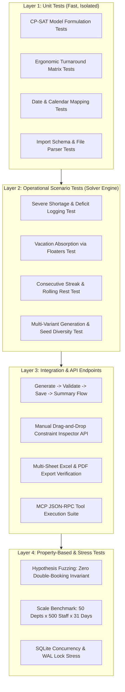

# Quality Assurance, Edge Cases & Verification Strategy
## LocalRoster v2: Dynamic Offline Workforce Roster Planner

---

### 1. Executive Summary & Verification Philosophy

Workforce scheduling software operates in a mission-critical domain. In healthcare, emergency services, and manufacturing, scheduling errors can lead to unsafe worker fatigue, regulatory labor violations, or unstaffed operational facilities.

LocalRoster v2 adheres to a **Zero Infeasible Crashes, Zero Silent Violations** philosophy:
1. **Never Crash with `INFEASIBLE`:** Under impossible staffing shortages, the mathematical engine must degrade gracefully, using penalized deficit slack variables to deliver the best-effort schedule while precisely logging gaps.
2. **Never Violate Hard Ergonomic Constraints:** Under no circumstances may an automated solve produce back-to-back turnaround breaches, double-bookings, or rolling rest violations.
3. **Resilient Data Ingestion:** Messy spreadsheet imports, conflicting manual pre-fills, or corrupt inputs must be caught and reported at the validation perimeter before affecting SQLite state.

---

### 2. Comprehensive Edge Case Catalog

#### 2.1 Ergonomic & Labor Rule Edge Cases

| ID | Edge Case Scenario | Potential Failure Mode | Expected Defensive System Behavior |
| :--- | :--- | :--- | :--- |
| **EC-ERG-01** | **Cross-Midnight Shift Turnaround**<br>Night shift runs 22:00–06:00 (crosses midnight). Next day's Morning shift starts at 07:00. | Solver treats 06:00 end time as earlier than 22:00 on the same date, miscalculating rest interval. | Rest calculation computes absolute minutes: $\Delta t = (1440 - 22 \times 60) + 7 \times 60 = 540 \text{ min} = 9.0 \text{ hrs}$. Since $9.0 < 14.0$, pair is added to $ForbiddenTransitions$. |
| **EC-ERG-02** | **Horizon Boundary Rest (Day 0 Turnaround)**<br>An employee worked Night shift on the final day of the *previous* month ($t = -1$). | Solver assigns Day 0 Morning shift because previous month history is unobserved. | System supports `history_lookback_days = 7`. Previous assignments are loaded to constrain the first 7 days of the new horizon. |
| **EC-ERG-03** | **Sliding Window Boundary (5 Consecutive Days)**<br>Employee works days 26, 27, 28, 29, 30 of current month and days 1, 2 of next month. | Monthly batching creates an illegal 7-day streak across month boundaries. | Lookback buffer checks trailing shifts from the prior plan before solving. |
| **EC-ERG-04** | **Leap Year & Month-End Variations**<br>February in leap years (2028: 29 days vs. 2027: 28 days) or 31-day months. | Off-by-one errors in calendar horizon generation causing index out-of-bounds. | Horizon length $|T|$ is dynamically derived via Python standard library `calendar.monthrange(year, month)[1]`. |
| **EC-ERG-05** | **Pre-Approved Leave Spanning Across Month Boundary**<br>Leave from Oct 28 to Nov 5. | November roster ignores leave starting in October. | Leave queries filter by `end_date >= plan_start AND start_date <= plan_end`, properly locking dates Nov 1–5. |

#### 2.2 Multi-Skilling & Cross-Department Floating Edge Cases

| ID | Edge Case Scenario | Potential Failure Mode | Expected Defensive System Behavior |
| :--- | :--- | :--- | :--- |
| **EC-FLT-01** | **The "Ping-Pong" Floater**<br>A multi-skilled floater is scheduled to Dept A on Monday, Dept B on Tuesday, Dept A on Wednesday, Dept C on Thursday. | High cognitive friction and exhaustion due to erratic department hopping. | Add soft floater continuity incentive or penalty on daily department switches ($Z_{e, d_1, t} + Z_{e, d_2, t+1} \implies \text{penalty}$). |
| **EC-FLT-02** | **Rank Priority Inversion**<br>Solver borrows an Emergency Floater (Rank 3) while an eligible Backup Floater (Rank 2) is left resting. | Sub-optimal skill deployment. | Enforced by strict weight hierarchy: $W_{float3} (5,000) \gg W_{float2} (1,000)$. Solver will never pick Rank 3 over Rank 2. |
| **EC-FLT-03** | **Cascade Department Starvation**<br>Dept A borrows from Dept B to fix a deficit, which in turn causes Dept B to plunge into a deficit. | Deficit shifting without net gain. | Solved via global objective: A deficit in Dept B costs $1,000,000$, whereas a float costs $1,000$. The solver will only float if Dept B has surplus capacity. |
| **EC-FLT-04** | **Universal Floater Exploitation**<br>An employee marked eligible for all departments absorbs 100% of floating duties, while others float 0 times. | Severe unfairness and burnout. | Objective includes $L_1$ variance penalty on floating duties: $W_{fair} \sum |Float_e - \overline{Float}|$. |
| **EC-FLT-05** | **Zero-Floater Isolation**<br>A specialized department (e.g. NICU) has no secondary floaters qualified, and its home staff are all on leave. | Solver crashes or attempts to assign unqualified staff. | Hard eligibility constraint $X_{e, d, s, t} \le Eligible_{e, d}$ prevents illegal assignments. Deficit slack absorbs the vacancy with reason `EXHAUSTED_ELIGIBLE_STAFF`. |

#### 2.3 Pre-Filling & Partial Roster Edge Cases

| ID | Edge Case Scenario | Potential Failure Mode | Expected Defensive System Behavior |
| :--- | :--- | :--- | :--- |
| **EC-PIN-01** | **Manager Pins Impossible Double-Shift**<br>Manager manually pre-fills Employee 10 to Morning ICU AND Night ER on the same calendar day. | Direct contradiction with hard constraint $\sum X \le 1$, causing integer solver failure. | Pre-solve validation detects double-booking *before* solver invocation. Displays modal: *"Conflict: Employee 10 double-booked on Nov 3. Fix to continue."* |
| **EC-PIN-02** | **Manager Pins Shift on Approved Leave Date**<br>Manager pre-fills a shift on a date when employee has approved annual leave. | Conflict between $Pinned$ ($X=1$) and $LockedOff$ ($Y=0$). | Pre-solve conflict auditor alerts manager: *"Sarah Connor has approved vacation on this date. Override vacation or unpin shift?"* |
| **EC-PIN-03** | **Manager Pre-Fills Over-Staffed Demand**<br>Requirement is 2 workers; manager pins 4 workers to that specific shift. | Demand equality constraint $\sum X + Deficit = RequiredStaff$ violated because $4 + Deficit \neq 2$. | Formulate demand as $\sum X + Deficit \ge RequiredStaff$ or adjust $Deficit$ formulation to allow negative slack (surplus) if pinned staff exceeds requirements. |
| **EC-PIN-04** | **Manager Pins 7 Consecutive Days**<br>Manager locks employee for Monday through Sunday without days off. | Contradicts rolling 7-day rest requirement ($\le 5$ shifts per 7 days). | Pre-solve auditor blocks the solve and flags the specific employee with the exact rule violation. |

#### 2.4 Operational Regimes & Non-24x7 Operating Edge Cases

| ID | Edge Case Scenario | Potential Failure Mode | Expected Defensive System Behavior |
| :--- | :--- | :--- | :--- |
| **EC-OPR-01** | **Night Shift on Weekday-Only Clinic**<br>Clinic operates Monday–Friday. A Night shift starting Friday 22:00 ends Saturday 06:00. | System cancels shift because Saturday is closed, leaving Friday night unstaffed. | Shift ownership is pegged to the shift *start date* ($t$). If Friday is an operational day, the cross-midnight shift completes legally. |
| **EC-OPR-02** | **Mid-Month Operating Schedule Change**<br>Department changes from 24x7 to Weekdays-Only mid-month due to renovations. | Recurring day-of-week rules fail to capture temporary date-specific shutdowns. | System supports **Specific Date Demand Overrides** taking precedence over weekly templates. |
| **EC-OPR-03** | **Zero-Demand Shifts**<br>A department requires 0 staff on Sunday Evening. | Solver assigns a worker anyway to satisfy an individual preference. | Unfilled demand is penalized, but surplus unrequested staffing is penalized via a small idle-cost penalty ($W_{surplus}$). |

#### 2.5 Data Import & Ingestion Edge Cases

| ID | Edge Case Scenario | Potential Failure Mode | Expected Defensive System Behavior |
| :--- | :--- | :--- | :--- |
| **EC-IMP-01** | **Dirty Employee Spreadsheet**<br>Uploaded Excel has duplicate `EMP001`, blank employee names, or negative `max_hours_week`. | Database integrity error or unhandled Python traceback. | Staging validator parses file row-by-row, collects all errors into a structured JSON report, and rejects commit until fixed. |
| **EC-IMP-02** | **Orphaned Department Code in Shift Matrix**<br>CSV demand matrix references `DEPT_X` which does not exist in SQLite. | Foreign key constraint crash during database insertion. | Import validator cross-references active department codes in DB; returns row-level error: *"Department DEPT_X not found."* |
| **EC-IMP-03** | **Malformed Date Strings**<br>User uploads leave file with dates formatted as `05/11/2026` instead of ISO `2026-11-05`. | SQLite date comparisons fail silently or corrupt queries. | Date parser attempts multi-format parsing (ISO, US, European) and standardizes to ISO-8601 `YYYY-MM-DD`. |

---

### 3. Verification & Testing Matrix



---

### 4. Detailed Test Suite Specifications

#### 4.1 Unit Test Suite (`tests/unit/`)

##### `test_ergonomics.py`
* **Test 1: Forbidden Shift Transition Generator:**
  - *Input:* Morning (07:00–15:30), Evening (15:00–23:30), Night (23:00–07:30), `min_rest = 14 hrs`.
  - *Assert:* `(Night, Morning) in forbidden_transitions`.
  - *Assert:* `(Night, Evening) in forbidden_transitions` (rest is $15:00 - 07:30 = 7.5\text{h} < 14\text{h}$).
  - *Assert:* `(Morning, Night) not in forbidden_transitions` (rest is $23:00 - 15:30 = 7.5\text{h}$ on same day? Handled via calendar day checks).

##### `test_calendar.py`
* **Test 2: Real Calendar Alignment & Leap Years:**
  - *Input:* Year `2028`, Month `2` (Leap year).
  - *Assert:* Horizon length $|T| == 29$.
  - *Assert:* Feb 1, 2028 maps to Tuesday (`DoW = 1`).
  - *Input:* Year `2026`, Month `11`.
  - *Assert:* Horizon length $|T| == 30$.
  - *Assert:* Nov 1, 2026 maps to Sunday (`DoW = 6`).

##### `test_import_validator.py`
* **Test 3: Spreadsheet Validation Perimeter:**
  - *Input:* CSV containing 3 valid employees, 1 duplicate code, 1 negative hour value.
  - *Assert:* Preview returns `valid_rows == 3`, `invalid_rows == 2`.
  - *Assert:* Database transaction does not commit when `skip_invalid == False`.

---

#### 4.2 Solver Scenario Tests (`tests/solver/`)

##### `test_shortage_handling.py`
* **Scenario: Severe Workforce Starvation (Infeasibility Shield Test):**
  - *Setup:* 2 departments (ICU, ER). Demand: 4 staff per shift, 3 shifts per day $\times$ 30 days = $240$ shift slots.
  - *Workforce:* Only 3 employees total.
  - *Expected Outcome:*
    - Solver status: `FEASIBLE` or `OPTIMAL` (NEVER `INFEASIBLE`).
    - $Deficit_{d, s, t} > 0$ populated for every unstaffed slot.
    - Zero double-booking: $\sum_{d, s} X_{e, d, s, t} \le 1$ for all 3 employees across all 30 days.
    - Diagnostic log accurately records the exact deficit count: $240 - \text{shifts worked}$.

##### `test_floating_absorption.py`
* **Scenario: Sickness / Vacation Absorption:**
  - *Setup:* Dept A has 4 staff; Dept B has 6 staff.
  - *Event:* 3 of 4 staff in Dept A take annual leave for 10 days.
  - *Eligibility:* 2 staff in Dept B are marked as Rank 2 Floaters for Dept A.
  - *Expected Outcome:*
    - Dept A minimum demand is satisfied.
    - Solver automatically assigns the 2 eligible floaters from Dept B to Dept A.
    - Floating badges and rank penalties are properly applied in objective calculation.

##### `test_rest_rules.py`
* **Scenario: Rolling Rest Inviolability:**
  - *Setup:* 10 staff over 30 days under heavy demand.
  - *Assert (Invariant 1):* In every 7-day window $[t, t+6]$, no employee works $> 5$ shifts ($R = 2$).
  - *Assert (Invariant 2):* No employee works $> 5$ consecutive days ($C_{max} = 5$).
  - *Assert (Invariant 3):* Zero occurrences of Night followed immediately by Morning.

---

#### 4.3 Property-Based Fuzzing with `Hypothesis` (`tests/property/`)

Using Python's `hypothesis` library to generate hundreds of random organizational topologies:
```python
from hypothesis import given, strategies as st

@given(
    num_depts=st.integers(min_value=1, max_value=8),
    num_employees=st.integers(min_value=4, max_value=30),
    horizon_days=st.sampled_from([7, 14, 28, 30, 31]),
    leave_probability=st.floats(min_value=0.0, max_value=0.3)
)
def test_universal_invariants(num_depts, num_employees, horizon_days, leave_probability):
    scenario = generate_random_scenario(num_depts, num_employees, horizon_days, leave_probability)
    result = solve_roster(scenario)
    
    # Invariant 1: Solver never raises uncaught Exception
    assert result.solver_status in ["OPTIMAL", "FEASIBLE"]
    
    # Invariant 2: No double assignments on any day
    for e in scenario.employees:
        for t in range(horizon_days):
            daily_assignments = [
                1 for d in scenario.departments for s in scenario.shifts
                if result.is_assigned(e, d, s, t)
            ]
            assert sum(daily_assignments) <= 1
            
    # Invariant 3: No assignments on approved leave days
    for (e, t) in scenario.approved_leaves:
        assert not result.works_on_day(e, t)
```

---

#### 4.4 Scalability & Performance Benchmarks (`tests/benchmarks/`)

Performance regression tests executed against fixed hardware baselines:

| Test Name | Scale Parameters | Max Allowed Solve Time | Success Criteria |
| :--- | :--- | :--- | :--- |
| **`bench_small`** | 2 Depts, 10 Staff, 14 Days, 3 Shifts | $\le 1.0 \text{ second}$ | Optimal solve, 0 deficits. |
| **`bench_target`** | 6 Depts, 50 Staff, 30 Days, 3 Shifts | $\le 10.0 \text{ seconds}$ | Feasible/Optimal solve, equitable spread. |
| **`bench_stress`** | 20 Depts, 250 Staff, 31 Days, 4 Shifts | $\le 45.0 \text{ seconds}$ | Integer solution convergence, $< 500\text{MB}$ RAM. |
| **`bench_extreme`**| 50 Depts, 500 Staff, 90 Days, 4 Shifts | $\le 120.0 \text{ seconds}$ | Bounded integer relaxation without memory exhaust. |

---

### 5. Automated CI/CD Testing Pipeline

When testing code is written in subsequent phases, the test runner must enforce:
1. `pytest tests/unit/` (Fast unit tests: target $< 3$ seconds total).
2. `pytest tests/solver/` (Operational constraint verification: target $< 20$ seconds).
3. `pytest tests/api/` (FastAPI route integration & JSON schema checks).
4. `pytest tests/benchmarks/` (Performance ceiling validation).
5. **Coverage Target:** Minimum $\ge 90\%$ code coverage across `src/solver/` and `src/services/`.
